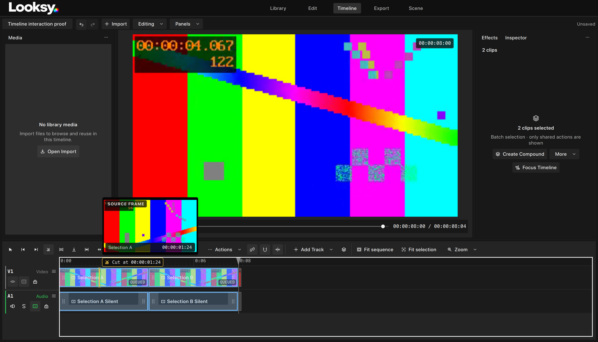

# Library, cutout, search, and Timeline validation — 2026-10-26

The changes were integrated into the macOS release build using three Luna agents at xhigh plus the coordinating agent. Unrelated working-tree edits were preserved. No user catalog or saved recipe was reset.

## Result

| Area | Change and evidence |
| --- | --- |
| Library startup | Publish compact metadata first, then hydrate saved recipes in bounded batches. The same live catalog helper workload fell from 352,715,309 bytes / 8.376 s to 88,892 bytes / 0.556 s. This measures initial metadata delivery, not completion of every thumbnail. |
| Saved-edit fidelity | All 171 deferred recipe rows matched the full snapshot exactly across both recipe columns, including all 16 assets with saved recipes. Editing, export, batch operations, automation reads, and agent proof rendering wait for the required recipes. |
| Subject cutouts | New linked cutouts preserve the adjustments beneath them. Independent and clipboard cutouts bake that source once. Only an untouched auto-created selection helper is removed; edited, renamed, or user-created layers remain. Existing markerless recipes retain their behavior. |
| AI Search | Pass only five preview/reference fields to inference. Prepare the filtered photo scope before freezing the snapshot, allow cancellation, and invalidate stale inputs. Defer the freeze until the complete preview-publication notification sequence has returned. |
| Timeline interaction | Empty-space rectangle selection, selection fill/border/glow, clip boundaries, tool cursors, blade guide with source-frame popup, proportional short clips, and controls that hide when they cannot fit. Video filmstrips decode distinct source frames rather than repeating a poster. |
| Video playback | Frames without decoder timestamps bypass expensive decoded-content cache hashing during continuous playback. Paused seeks retain exact content-based caching. |

## Live search coverage

The actual catalog contains **171 items: 170 photos and one video**. Two source files are missing. With recipes still unloaded at admission, the production catalog binding prepared and encoded **168 current photo previews**, then returned 32 similarity candidates for `green hat`. The two unavailable photo previews were explicitly reported as unsearched. No similarity result was labeled a verified detail match.

This proof exercised the real catalog binding and bundled offline model through the C++ entry point. It did not click the QML Find photos button or evaluate whether each ranked candidate contains a green hat. The subsequent deferred-publication race fix is covered by the final binding regression test.

The proof used private application data, a copy-on-write clone of recipe sidecars, a private thumbnail cache, and a private embedding index. Source paths and database credentials are not included in the search receipt.

## Native 4K-source playback

The workload was a moving 3840 × 2160, 30 fps H.264 fixture with no audio or authored effects, played for ten seconds in the Cocoa Timeline with Full preview quality. The processed monitor image was **1738 × 978**; this is viewport preview performance, not a 4K output/export claim.

| Metric | Before | Accepted change |
| --- | ---: | ---: |
| Published frames per second | 17.28 | 29.87 |
| Reported dropped frames | 126 | 0 |
| Decode/normalization time, end-of-run average | 57.45 ms | 5.20 ms |
| UI heartbeat p95 | 18 ms | 20 ms |
| Sequence progress | 10.005 s | 10.000 s |

The declared gates were at least 27 fps, no more than 15 dropped frames, at least nine seconds of sequence progress, and UI heartbeat p95 no greater than 50 ms. Trimmed, accelerated, and reversed source-time mappings matched the document mapper; save/reopen preserved the document hash.

The bounded performance loop rejected and reverted an initial parallel-row conversion experiment that reached only 18.78 fps. The accepted second hypothesis avoids hashing every full decoded frame when continuous playback would normally miss the cache. Pixel and color-profile hashes matched exactly across **66 conversion cases**, and a dedicated regression checks live changed-frame publication plus restoration of exact paused cache behavior.

The existing scale test also passed with 10,000 clips and a four-hour sequence: load 196 ms, projection 267 ms, seek p95 4 ms, selection p95 2 ms, edit p95 26 ms, undo p95 4 ms, and measured RSS growth 378 MiB. This is controller stress evidence, not sustained playback of 10,000 clips.

## Native UI evidence

Native fixture captures verify Library loading/empty/populated states, delayed thumbnails, Inspector updates, and stable mixed-aspect layouts after resize. The startup test now targets the current inline loading scene instead of the removed popup. Readiness notifications produced no QML errors after correcting the context-controller references.

The native Timeline fixture verifies real pointer-event routing through the QQuickWindow, marquee geometry, selected clip styling, tiny-clip bounds, tool cursors, a frame-aligned blade cut and one-step Undo, distinct decoded filmstrip frames, and a source-frame popup inside the native window above the cut. These are automated native-window interactions, not a complete human editing session.

## Tests and limits

The final host run passed **all 19 focused CTest cases** in 85.64 s. Coverage includes catalog hydration and preview provenance; search preparation, cancellation, and scope changes; generated subject masks and cutout pixel fidelity; clipboard paste; recipe persistence and thumbnail identity; Timeline selection, palette, track surface, frame scheduling, color conversion, and native Library startup. `cargo test --workspace` passed; four catalog tests remain ignored by their existing configuration.

The broader `photo_document_workflow_test` initially failed the movable Base Image ordering/export assertion. On the latest source it passed that assertion with zero pixel error, then stopped because its display-ICC paint-parity case had no configured ICC profile asset. That broader ICC case remains unqualified. The linked-cutout clipboard regression has its own registered test and passes independently. There is no full-suite or release-readiness claim.

The catalog model's offline import fixture also initially timed out on the host: the real TCP preflight rejected its fake helpers before execution. Its fixture now uses an explicit nonnetwork database URL, preserving the same negative-import/job-persistence assertions on both host and sandbox.

Small receipts and the final source/binary identity manifest are in [validation-artifacts/2026-10-26-library-cutout-timeline](validation-artifacts/2026-10-26-library-cutout-timeline). Temporary detailed logs are under `/private/tmp/looksy-*`.

Follow-up: the native monitor-ICC gap described above is now closed for the exercised paint/document paths. See [native ICC and real-photo workflow validation](icc-real-photo-workflow-2026-10-26.md) for the strict Cocoa/Metal results, real-RAW batch-sync fix, fresh-process reopen proof, and remaining limits.
