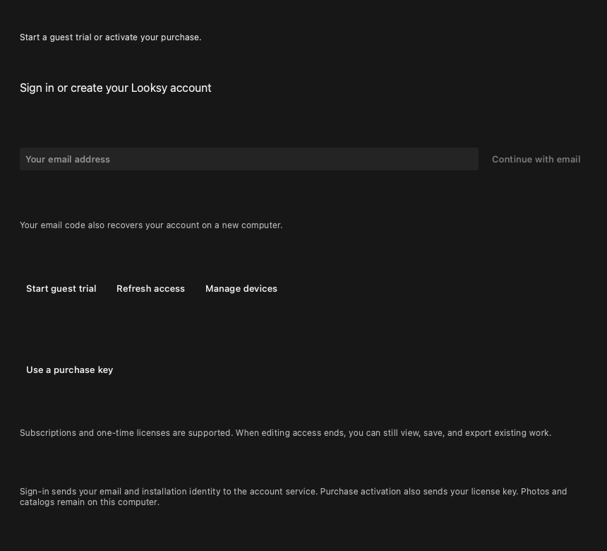
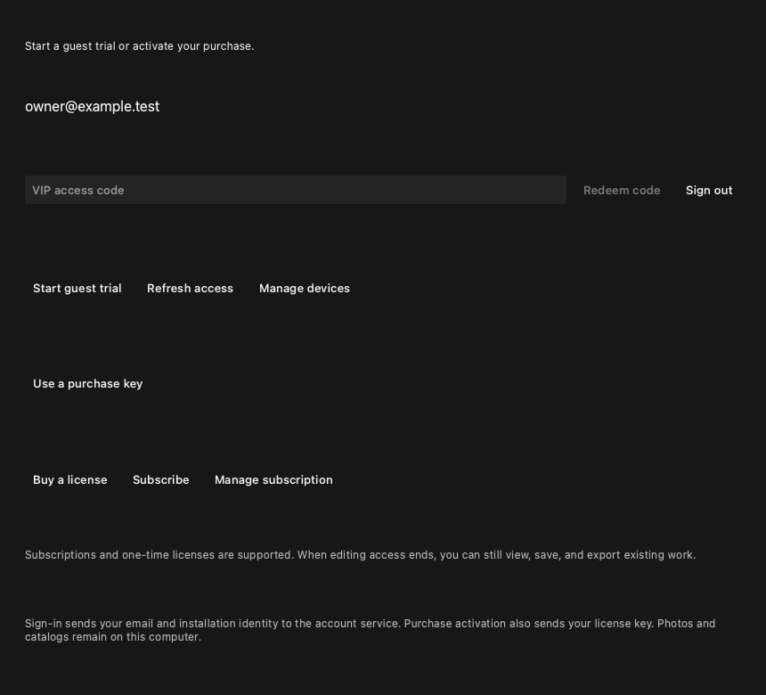

# Customer accounts and private staging implementation evidence

Canonical acceptance remains in [the production launch checklist](../../production-launch-checklist.md).
This record covers local implementation and focused checks, not a hosted/signed release.

Implemented email-code accounts and 30-day installation sessions, account recovery,
issuer-scoped desktop credentials/cache, support/admin boundaries, audited VIP code
creation/redemption/revocation/reissue, Paddle checkout/portal/fulfillment and refund
handling, a hosted checkout page, bounded support bundles and incident IDs, isolated
crash consent/queues, strict staging update channels and public staging configuration.
Legacy Lemon Squeezy purchases remain supported. See [commercial configuration](../../commercial-launch.md)
and [the service setup guide](../../customer-platform-setup.md).

Validation on 2026-11-17:

- macOS Release `photo_editor_app` target built successfully with the new QML/controllers.
  Its default configuration still has customer API empty, Sparkle off and crash reporting off.
- Five focused native tests passed: `customer_access_controller_test`,
  `customer_account_panel_test`, `customer_expiry_workflow_test`,
  `crash_reporting_controller_test` and `app_shell_controller_test`.
- Customer service `npm run check` passed under Node 24: typecheck, 36 setup checks,
  70 Worker/D1 cases across five test files. Two opt-in integration cases are excluded
  by default. Wrangler dry-run bundling passed; nothing was deployed.
- The opt-in backup rehearsal separately preserved all 18 tables in a fresh local D1
  restore, including account/VIP/Paddle rows, schema, indices and triggers. Staff SQL
  integration passed earlier; later repetitions timed out during host slowdown.
- Checkout page: 10 Node tests passed. Existing download page: six tests passed.
  Commerce configuration: 17 Python tests passed. Staging configuration: four tests
  passed. Appcast rollout and edit-admission inventory/self-tests passed.
- Shared popup/style audit passed directly after the email-code numeric styling fix.
- Full non-Metal headless build passed. The new unavailable-backend test and all three
  previously failing color contracts passed locally. These exercise the cross-platform
  source path, not an actual Windows runner.
- The broader 92-case headless run had 89 passes, one skip, a retouch performance
  timeout and the numeric-entry style failure subsequently corrected above. A later
  CTest wrapper of the popup audit timed out during severe host slowdown, while direct
  audit passed. Do not describe the broad headless suite as fully passing or these
  timings as performance qualification.

A focused test exposed a stale test clock snapshot across legitimate refreshes; it
now compares exact lease/clock/credential state immediately before failed recovery.
No access check was relaxed. The permission inventory now discovers controller
methods across split source files; new compound-render automation starts require
admission, while cancellation and existing-work save/export remain available.

## Reproduce focused checks

Use the repository build lock before configuring/building. Use Node 24 for the service.
The local Worker and fake native HTTP service need loopback access.

```sh
cd services/customer-platform
npm run check
npx wrangler deploy --dry-run --outdir /tmp/looksy-worker
cd ../..
ctest --test-dir build/release-macos -R '^(customer_access_controller_test|customer_account_panel_test|customer_expiry_workflow_test|crash_reporting_controller_test|app_shell_controller_test)$' --output-on-failure
node --test scripts/test-checkout-page.cjs scripts/test-download-page.cjs
python3 scripts/test-staging-desktop.py
python3 scripts/check-customer-edit-admission.py
python3 scripts/test-check-customer-edit-admission.py
```

## Account-panel fixture captures

These screenshots render the real QML Account panel with synthetic controller data
using Qt's offscreen platform. They are layout/interaction evidence, not a signed
installed account-service walkthrough or real payment/delivery proof.





## Remaining acceptance

Configure Paddle sandbox products/default payment-link domain and public token;
verified Resend sender; isolated Cloudflare D1/Worker/Access with owner MFA; actual
Apple and Windows signing; Sentry SDK/handler/symbol uploads; private signed feeds.
Then build fresh managed installers and run real email delivery, both purchase offers,
refunds, VIP/admin operations, revocation/offline expiry, crash delivery and signed
A-to-B updates on Mac and Windows. A previous DMG is stale and has these services off.

General CI, dependency advisories, package duplication and earlier desktop regressions
remain separate release gates. Local preparation never activates production resources.
